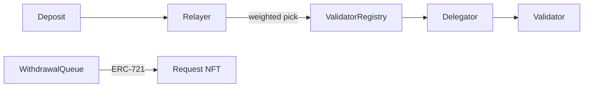

<h1>

minato

Ariyan Kashyap 👋

</h1>

[Email](mailto:work.kashyapariyan@gmail.com) · [LinkedIn](https://www.linkedin.com/in/ariyan-kashyap-1683541a1) · [GitHub](https://github.com/0x-minato)

**BUILDING THINGS THAT ACTUALLY WORK.**

<table>
<tr><th align="left">now</th><td>LLM applications · RAG · agents</td></tr>
<tr><th align="left">shipped</th><td>Troves $40K → $25M peak · Endur $0 → $50M peak</td></tr>
<tr><th align="left">open</th><td>engineering roles and interesting collaborations</td></tr>
<tr><th align="left">runtime</th><td>curiosity ✅ &nbsp; caffeine ✅ &nbsp; sleep ❌ &nbsp; touching grass still in the backlog 🌱</td></tr>
</table>

---

## 🧪 try a call

Three buttons. One of them is the real trade. The other two are a mess. Click one. 👇

<kbd>1</kbd>&nbsp;&nbsp;<code>loop --bounded</code> &nbsp; the careful one

 

Lets gooo 🟢 the loop held, nobody got liquidated, and yield moved <b>20–30%</b>. Now tell the world... properly.

 

<kbd>1.a</kbd>&nbsp;&nbsp;<code>push defillama adapter</code>

 
SHIPPED 🚀 TVL went from <b>$40K</b> to a <b>$25M</b> peak and anyone can check it. This is the Troves one. You cooked. 👨‍🍳

 

<kbd>1.b</kbd>&nbsp;&nbsp;<code>announce it in discord</code>

 
lol no 😂 a discord message is not a source of truth. You built the adapter for this. Close this and hit <kbd>1.a</kbd>.

<kbd>2</kbd>&nbsp;&nbsp;<code>loop --yolo</code> &nbsp; 400% APY, no brakes

 

oh nooo the trade blew up 💥🫠 health factor said goodbye, the loop ate itself, and you ARE the liquidity now. Revert. Try the careful one.

<kbd>3</kbd>&nbsp;&nbsp;<code>delegatecall(stranger)</code>

 

absolutely not 🚫👀 you just handed the keys to a random contract. The diamond was RIGHT there. This one reverts before you become a postmortem. 💀

---

## 🧑‍💻 About Me

Engineer with experience building **DeFi infrastructure, backend, smart contracts and distributed blockchain systems**, currently expanding into **AI engineering**.

I enjoy working on complex engineering problems, from designing smart contract architectures to building intelligent applications powered by LLMs.

- 🤖 Exploring LLM applications, RAG and agentic workflows.
- ⚙️ Building backend systems with Node.js, TypeScript and PostgreSQL.
- 🔗 Previously worked on DeFi protocols across Ethereum and Starknet.
- 🚀 Interested in AI engineering, backend infrastructure and distributed systems.

---

## ⚡ Tech Stack

### Languages

### Backend & Systems

&nbsp;&nbsp;&nbsp;&nbsp;

### AI & Agents

&nbsp;&nbsp;&nbsp;&nbsp;&nbsp;&nbsp;&nbsp;&nbsp;

### Blockchain

&nbsp;&nbsp;&nbsp;&nbsp;&nbsp;&nbsp;&nbsp;&nbsp;&nbsp;&nbsp;

### Databases & ORMs

&nbsp;&nbsp;

### Frontend

&nbsp;&nbsp;&nbsp;&nbsp;&nbsp;&nbsp;

### Tools & Infrastructure

&nbsp;&nbsp;

---

## 💼 Experience

### 🔹 Software Engineer — TrovesFi / StrkFarm

*Starknet · DeFi Infrastructure · Yield Aggregation*

- Took Troves from $40K to a $25M peak TVL by shipping leveraged-looping, flash-loan and liquidity-management strategies in Cairo, with pricing models that lifted token yields 20–30% while tightening liquidation bounds.
- Built ERC-4626 vaults in Cairo covering share accounting, position management and reward distribution.
- Integrated external yield protocols, writing the contract calls that execute strategy operations, plus TVL and yield adapters published on DeFiLlama.
- Worked on off-chain strategy execution workflows and contract interaction logic.
- Validated strategy behavior with Snforge Foundry fork tests.

**Stack:** Cairo · Starknet · TypeScript · ERC-4626 · Snforge · Foundry

### 🔹 Software Engineer — EndurFi

*Liquid Staking · Backend Automation · Protocol Infrastructure*

- Co-developed Endur's liquid staking protocol from zero and scaled it to a $50M peak TVL, implementing multi-validator staking with configurable validator weights, permissions and per-token configs that the relayer reads on every deposit.
- Developed relayer-side logic for automated stake allocation, including weighted validator selection and deposit routing.
- Implemented off-chain workflows coordinating staking operations across LST, ValidatorRegistry, Delegator and WithdrawalQueue contracts.
- Worked on withdrawal processing involving ERC-721 request NFTs, pending withdrawal tracking and unstaking operations.
- Contributed to the integration of asynchronous relayer operations with on-chain protocol state.
- Performed mainnet-fork testing to validate multi-validator staking and withdrawal flows.

**Stack:** Solidity · TypeScript · Starknet · Relayers · Foundry · ERC-721

trace a deposit

 

### 🔹 Software Engineering Intern — Hashstack

*DeFi Lending · Smart Contract Architecture · Cross-chain Infrastructure*

- Migrated lending core contracts from Cairo 0 to Cairo 2, including the migration plan and updates inside the core contracts.
- Ported Cairo 0 logic to Solidity through an EIP-2535 Diamond Proxy.
- Implemented cross-chain messaging flows between Starknet L2 and Ethereum L1.
- Worked on ETH staking integrations involving Lido and Stader.
- Tested core contracts with Snforge Foundry, including mainnet fork tests, and applied changes from audits.

**Stack:** Solidity · Cairo · Ethereum · Starknet · Diamond Proxy · Snforge

---

## 🚀 Featured Projects

### 🔗 DeFi Infrastructure

Previously contributed to Starknet yield aggregation and liquid staking systems, working on strategies, validator infrastructure and smart contract architecture.

`Solidity` `Cairo` `Starknet` `Foundry`

---

## 🌌 Beyond The Terminal

- 🎮 Gaming enthusiast.
- 🧩 Enjoy solving challenging engineering problems.
- 🌌 Curious about emerging technologies and how things work under the hood.
- ☕ Powered by curiosity and questionable amounts of caffeine.

<code>ps aux</code>

 

<code>caffeine</code> &nbsp; running, do not kill 
<code>curiosity</code> &nbsp; running 
<code>open-to-work</code> &nbsp; running, see below

---

### LET'S BUILD SOMETHING INTERESTING.

*Open to engineering opportunities and interesting collaborations.*

Pick a lane. Same inbox.

<kbd>a</kbd>&nbsp;&nbsp; an agent that finishes

RAG, LangGraph, and a backend that stays up.

[Email me about an agent](mailto:work.kashyapariyan@gmail.com?subject=An%20agent%20that%20finishes) · [LinkedIn](https://www.linkedin.com/in/ariyan-kashyap-1683541a1) · [GitHub](https://github.com/0x-minato)

<kbd>b</kbd>&nbsp;&nbsp; a protocol with real TVL

Vault math, relayers, fork tests.

[Email me about a protocol](mailto:work.kashyapariyan@gmail.com?subject=A%20protocol%20with%20real%20TVL) · [LinkedIn](https://www.linkedin.com/in/ariyan-kashyap-1683541a1) · [GitHub](https://github.com/0x-minato)

<kbd>c</kbd>&nbsp;&nbsp; something weirder

Say the weird part first.

[Email me about something weirder](mailto:work.kashyapariyan@gmail.com?subject=Something%20weirder) · [LinkedIn](https://www.linkedin.com/in/ariyan-kashyap-1683541a1) · [GitHub](https://github.com/0x-minato)

[GET IN TOUCH](mailto:work.kashyapariyan@gmail.com) · [LinkedIn](https://www.linkedin.com/in/ariyan-kashyap-1683541a1) · [GitHub](https://github.com/0x-minato)
